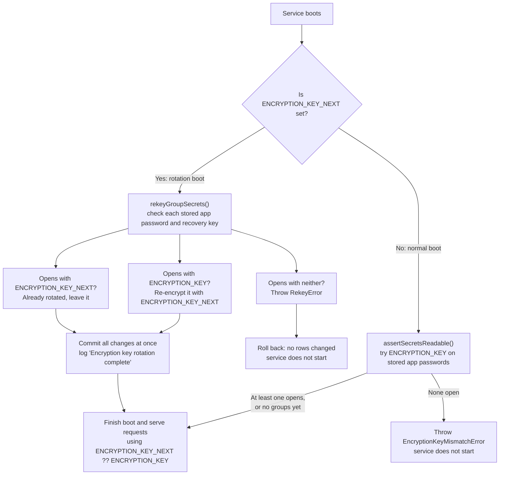

# Design: `ENCRYPTION_KEY` rotation

Status: **accepted**. Tracking: [TECH-777](https://linear.app/hypercerts/issue/TECH-777).
Trigger: Railway incident [QH8L8B3E](https://status.railway.com/incident/QH8L8B3E) may have exposed service env vars (not the volume). The current key is a sealed Railway variable, so rotation must not require reading it.

The operator runbook lives in [`docs/deployment.md`](../deployment.md#rotating-encryption_key).

## Problem

`ENCRYPTION_KEY` is a single AES-256-GCM key (`src/pds/credentials.ts`) protecting two columns in the global `groups` table:

| Column                   | Written by              | Read by                                    |
| ------------------------ | ----------------------- | ------------------------------------------ |
| `encrypted_app_password` | `api/group/finalize.ts` | `PdsAgentPool._login` (every PDS login)    |
| `encrypted_recovery_key` | `api/group/finalize.ts` | nothing at runtime (break-glass); nullable |

Per-group DBs and API keys hold no ciphertext under this key. Swapping the key makes every `decrypt()` fail, so there was no rotation path.

## Threat model

| Exposure                | Attacker can                     | Fix                                            |
| ----------------------- | -------------------------------- | ---------------------------------------------- |
| Env vars only           | Nothing; key without ciphertext. | **Rotate key** (this design)                   |
| Volume only             | Nothing; ciphertext without key. | Rotate key (defence in depth)                  |
| Env vars **and** volume | Decrypt every stored credential. | Re-issue credentials (out of scope, see below) |

## Approaches considered

1. **Re-key at boot with `ENCRYPTION_KEY_NEXT` (chosen).** No one reads the sealed key, no shell or volume access needed, request path stays single-key.
2. **Offline CLI.** Needs a stopped service with its volume mounted, awkward on Railway. The core function stays reusable if we want one later.
3. **Dual-key decrypt with lazy re-encrypt.** Keeps a fallback key on the hot path forever and never migrates the unread recovery keys. Rejected.

A `_PREVIOUS` variant (copy the old key into a new var) was rejected because it requires reading the sealed key.

## Design

Runtime key everywhere: `activeEncryptionKey(config) = ENCRYPTION_KEY_NEXT ?? ENCRYPTION_KEY`. Config rejects `ENCRYPTION_KEY_NEXT` equal to `ENCRYPTION_KEY` (case-insensitive).



```ts
// src/pds/rekey.ts
export function rekeyGroupSecrets(
  raw: Database.Database,
  keys: { oldKey: Buffer; newKey: Buffer },
): { groups: number; rekeyed: number; alreadyCurrent: number }

export function assertSecretsReadable(raw: Database.Database, key: Buffer): void
```

- Uses `raw` better-sqlite3 so the pass is one synchronous transaction with no `await` (see `src/db/sqlite.ts`). All rows commit or none do.
- Idempotent: values already under the new key are skipped, so restarts with `_NEXT` set are no-ops.
- GCM authentication makes "decrypts under the wrong key" negligible, so try/catch around `decrypt` is the membership test.
- Errors and logs carry DID, column and counts only, never keys or plaintext.
- Ownership: `index.ts` decides rotate vs check; `rekey.ts` owns the transaction and checks; `credentials.ts` owns the crypto.

### Boot readability check

Without it, a cut-over that leaves the old or a mistyped value in `ENCRYPTION_KEY` passes `/health` and then fails each group's first PDS login. The check runs only on non-rotation boots and fails only if `groups` is non-empty **and** no app password decrypts, so one corrupt row or a fresh install never blocks startup. It ignores recovery keys (unread at runtime). Limit: one readable row is enough, so a stray old-key row can mask a wrong key; the runbook's smoke test and confirming redeploy cover that.

### Keep / drop

- **Keep:** single-key `PdsAgentPool` and `finalize`; the ciphertext format (iv + tag + ciphertext, base64).
- **Drop:** runtime fallback decrypt; key IDs or versioning in ciphertext. Revisit if rotation becomes routine.

## Operational caveats

- The re-key commits before the rest of boot. If a deploy fails after the log line, keep `_NEXT` set and redeploy; removing it leaves `ENCRYPTION_KEY` unable to read the rows. Do not roll back to a pre-rotation build.
- If the platform overlaps old and new deploys, the old one still holds only the old key and can write new rows under it (`group.register` / `group.import`). One more redeploy with `_NEXT` set picks them up (`rekeyed` > 0).

## Testing

- `tests/rekey.test.ts`: mixed old/new rows and counts; null recovery key left null; unknown-key row throws `RekeyError` with full rollback; second run is a no-op; empty table; empty-string plaintext; `assertSecretsReadable` pass/fail cases.
- `tests/config.test.ts`: `ENCRYPTION_KEY_NEXT` optional, 64 hex, must differ (case-insensitive).
- `finalizeGroup` encrypts under `_NEXT` when set.
- Boot wiring in `index.ts` is excluded from coverage, so it stays a few lines.

## Out of scope: volume also exposed

Rotation does not protect already-decrypted secrets. Per group: revoke and re-create the app password on the PDS (needs its own design, e.g. `app.certified.group.admin.rotateAppPassword`), and if a recovery key was stored, remove it from `rotationKeys` via a PLC operation and store a replacement.

## Open questions

1. Does Railway overlap old and new deploys on a service with a volume? Affects whether a failed rotation boot means downtime and whether the overlap caveat applies.
2. Recovery keys are verified during rotation (a corrupt one fails with `RekeyError`) but not by the normal boot check. Is that enough?
